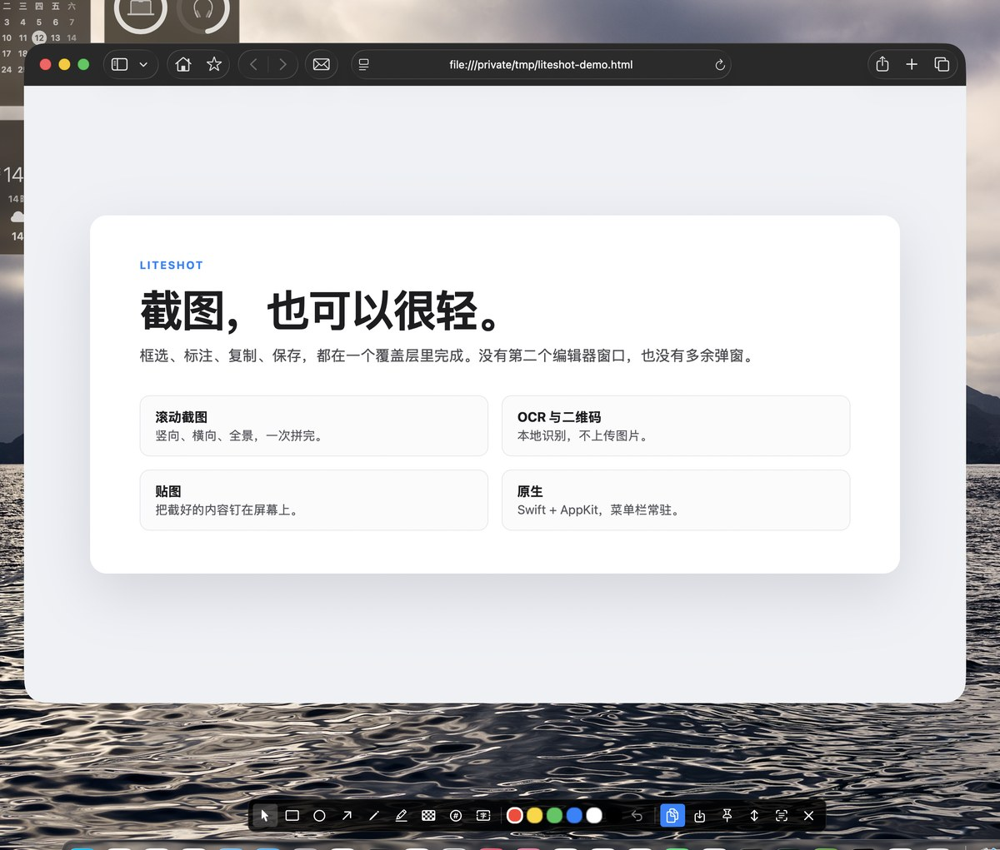

# Liteshot

一个菜单栏常驻的原生 macOS 截图与标注工具。框选、标注、复制、保存，都在一个覆盖层里完成。

**[官网与下载](https://redcarl.github.io/Liteshot/)** · **[源码](https://github.com/RedCarl/Liteshot)** · **[问题反馈](https://github.com/RedCarl/Liteshot/issues)**

---

## 这是什么

Liteshot 是一个 macOS 上的截图工具。它把「框选 → 标注 → 复制/保存」放进同一个覆盖层：拖出区域后工具条直接出现在选区旁，标注直接画在选区上，不会弹出第二个编辑器窗口。

它只做截图这一件事：区域、窗口、滚动截图、OCR、二维码、贴图和历史。原生 Swift + AppKit，MIT 开源，菜单栏常驻，不占 Dock。

---

## 能做什么

### 截图

- 一个入口完成区域 / 窗口 / 全屏：拖拽框选，点击窗口直接截取，点空白截全屏
- 选区支持放大镜、取色、边界吸附、Shift 正方形、方向键微调
- 顶部悬浮模式条：全屏、滚动、跨屏、延迟、上一次区域、OCR、二维码、历史

### 标注

- 矩形、椭圆、箭头、画笔、高亮、马赛克、序号、文字
- 6 色色板、撤销；选中元素可移动 / 缩放
- 标注直接画在选区内，Enter / 双击 / ⌘C 复制退出，⌘S 保存退出
- 没有第二个编辑器窗口

### 滚动截图

- 竖向、横向、全景（横竖同时）
- 开始滚动前可以改方向；HUD 实时缩略图，完成 / 取消
- 滚动过快会提示可能漏内容

### 识别

- OCR 文字识别（macOS Vision 本地识别，不上传）
- 二维码 / 条形码
- 结果窗口可上一个 / 下一个，保留最近 20 条

### 输出与效率

- PNG / JPEG、自动保存、复制到剪贴板、文件名模板
- 圆角 / 阴影 / 透明背景 / Retina 1x
- 钉图、截图历史（最多 50 张）、全局快捷键自定义
- 中英双语、菜单栏常驻

---

## 下载与安装

macOS 14 及以上，Apple 芯片与 Intel 都支持。

**下载：<https://redcarl.github.io/Liteshot/>**（页面会直接下载最新版）

- 下载的是 zip，解压后把 `Liteshot.app` 拖进「应用程序」
- 首次打开若提示「已损坏」或「无法验证开发者」：在 Finder 里右键 → 打开，或执行
  `xattr -dr com.apple.quarantine /Applications/Liteshot.app`
- 首次截图需要在 系统设置 → 隐私与安全性 → 屏幕与系统音频录制 中授权；应用会先显示自己的权限引导页
- 更新：菜单「检查更新…」，也可以在应用内提示时直接下载新版

---

## 常用操作

| 操作 | 方式 |
|---|---|
| 开始截图 | 菜单栏图标「开始截图」或 ⌃⌘A |
| 框选 / 窗口 / 全屏 | 拖拽框选 / 点击窗口 / 点击空白或按 F |
| 顶部模式条 | 全屏、滚动、跨屏、延迟、上次区域、OCR、二维码、历史 |
| 选区工具条 | 矩形、椭圆、箭头、画笔、高亮、马赛克、序号、文字、色板、撤销、复制、保存、钉图、滚动、OCR、关闭 |
| 复制 / 保存 / 取消 | Enter / 双击 / ⌘C；⌘S；Esc |
| 撤销 / 重做 | ⌘Z / ⇧⌘Z |
| 文字 | 回车确认，⇧回车换行，Esc 取消 |
| 设置 | 菜单「设置…」或 ⌘, |

---

## 常见问题

**截图后为什么没有弹出编辑器？**

这是设计：框选后工具条直接贴选区，标注就在覆盖层里完成，没有第二个窗口。

**为什么第一次截图要授权？**

macOS 要求「屏幕录制」权限。应用会先显示自己的权限引导页；点「授权屏幕截图」才会弹出系统授权框并打开设置页。

**截图保存在哪？**

默认在 `~/Pictures/Liteshot`，可以在 设置 → 保存 里改。复制到剪贴板默认开启。

**支持多显示器吗？**

支持。覆盖层会出现在鼠标所在的屏幕；跨屏区域在顶部模式条里。

**全屏截图会被刘海挡住吗？**

工具条会自动避开菜单栏 / 刘海和 Dock；截出来的图是完整屏幕。

**OCR 会上传图片吗？**

不会，使用 macOS Vision 本地识别。

**滚动截图怎么用？**

顶部模式条「滚动截图」→ 选方向 → 框选区域或点窗口 → 在区域内滚动 → 完成后点 HUD 的「完成」。

**怎么更新？**

菜单「检查更新…」，或按应用内提示下载最新版；下载后解压替换 `Liteshot.app`，不会自动安装。

**为什么没有上架 / 没有 Apple 公证？**

MIT 开源，用 ad-hoc 签名发布，未做 Apple 公证；首次打开需要右键打开。

---

## 免责声明

- 本项目是独立开源工具，与 QQ、微信、Longshot 等产品没有隶属关系。
- 截图内容只在本机处理；OCR 使用本地 Vision；只有「检查更新」会访问 GitHub API。
- 请勿用本工具截取、传播他人隐私或受版权保护的内容；使用产生的后果由使用者自行承担。
- 软件按 MIT 协议「按原样」提供，不附带任何担保。

---

## 更多

- 源码与问题反馈：<https://github.com/RedCarl/Liteshot>
- 更新记录：[CHANGELOG.md](CHANGELOG.md)
- 如果它好用，欢迎点个 Star。
- 技术细节在 [`docs/`](docs/)（交互对照、功能规划、技术选型），不属于使用文档。

## 许可证

[MIT](LICENSE) © 2026 RedCarl
